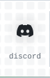

<!-- every image has a dark and a light version; dark sources use absolute raw URLs because GitHub does not document relative srcset -->

<picture>
  <source media="(prefers-color-scheme: dark)" srcset="https://raw.githubusercontent.com/KoRrNiK/KoRrNiK/main/assets/header.svg">
  
</picture>

<!-- one box: Discord status (60%) + five buttons (8% each); keep the six links on one line, any whitespace between them breaks the box apart -->

<a href="https://discord.com/users/292279578389643264"><picture><source media="(prefers-color-scheme: dark)" srcset="https://raw.githubusercontent.com/KoRrNiK/KoRrNiK/discord/discord.svg"></picture></a><a href="https://discord.com/users/292279578389643264"><picture><source media="(prefers-color-scheme: dark)" srcset="https://raw.githubusercontent.com/KoRrNiK/KoRrNiK/main/assets/discord.svg"></picture></a><a href="https://twitter.com/KoRrNiK1"><picture><source media="(prefers-color-scheme: dark)" srcset="https://raw.githubusercontent.com/KoRrNiK/KoRrNiK/main/assets/x.svg"></picture></a><a href="https://steamcommunity.com/id/korrnik"><picture><source media="(prefers-color-scheme: dark)" srcset="https://raw.githubusercontent.com/KoRrNiK/KoRrNiK/main/assets/steam.svg"></picture></a><a href="https://www.twitch.tv/korrnik_"><picture><source media="(prefers-color-scheme: dark)" srcset="https://raw.githubusercontent.com/KoRrNiK/KoRrNiK/main/assets/twitch.svg"></picture></a><a href="https://www.youtube.com/channel/UC_4mFRor64UwzhH5bRQYVmQ"><picture><source media="(prefers-color-scheme: dark)" srcset="https://raw.githubusercontent.com/KoRrNiK/KoRrNiK/main/assets/youtube.svg"></picture></a>

<picture>
  <source media="(prefers-color-scheme: dark)" srcset="https://raw.githubusercontent.com/KoRrNiK/KoRrNiK/main/assets/terminal.svg">
  
</picture>

<picture>
  <source media="(prefers-color-scheme: dark)" srcset="https://raw.githubusercontent.com/KoRrNiK/KoRrNiK/stats/stats.svg">
  
</picture>

<picture>
  <source media="(prefers-color-scheme: dark)" srcset="https://raw.githubusercontent.com/KoRrNiK/KoRrNiK/output/github-contribution-grid-snake-dark.svg">
  
</picture>

